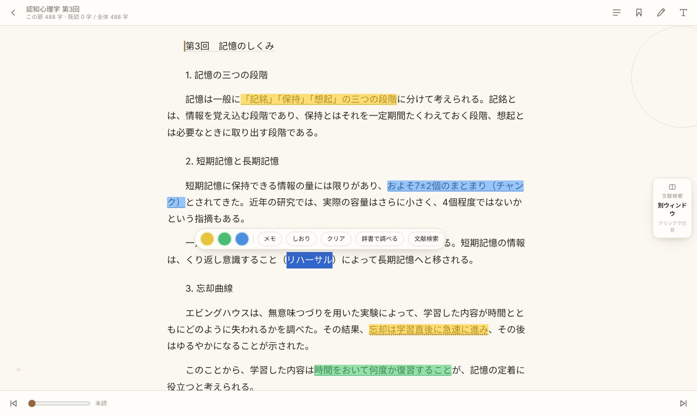
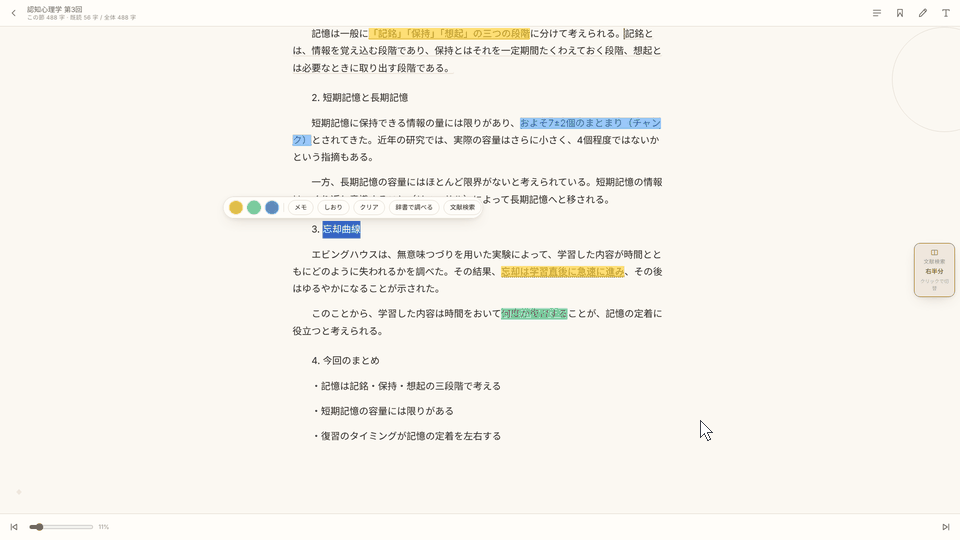
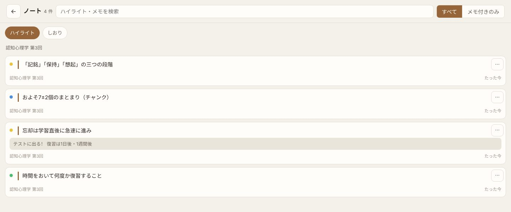

# E-Reader

日本の大学生が、ふだんの授業・ノート取り・文献読みに使うことを想定して作った Windows 用の電子書籍リーダーです。

授業資料（PDF・PPTX・DOCX）や論文を本棚に並べて、読みながらハイライトやメモを残し、あとで Word にまとめて書き出せます。わからない言葉や参考文献は、Google Scholar や辞書ですぐに調べられます。
ネット接続・登録は不要。本とノートは自分のパソコンにだけ保存されます。

## ダウンロード

[最新版はこちら](https://github.com/toaru10124/E-Reader/releases/latest) → 「Assets」の **E-Reader-v1.0.zip**

## 使い方

1. ダウンロードした zip を右クリック →「すべて展開」
2. `E-Reader.bat` をダブルクリック（警告が出たら「詳細情報」→「実行」）
3. 2 回目からは、同じフォルダにできる「E-Reader」ショートカットで開けます
4. くわしくは zip の中の「使い方.txt」へ

- 対応：Windows ＋ Chrome / Edge
- 形式：TXT / EPUB / PDF / DOCX / PPTX

## 主な機能

### 本棚
授業資料や論文を本棚に並べて管理。右側に「よく使うリンク」を自由に追加できます。

### 読む・ハイライト・メモ
文字を選ぶと、3 色のハイライト・メモ・しおりがすぐに使えます。

### 文献・辞書をすぐ調べる
選んだ言葉を「文献検索」「辞書で調べる」で検索。リーダーが左半分に縮み、右半分に検索の窓が開きます。検索の窓を閉じると元の大きさに戻ります。

### ノート
すべての本のハイライト・メモ・しおりを一覧で。Word ファイルに書き出したり、引用の形式でコピーしたりできます。

### オープニング
開くたびに、机の上で「書」の字が書かれます。右のカレンダーには今日の日付。

## フィードバック

AI を使ってアプリを作るのは、今回が初めてです。
使いにくいところや不具合など、どんなことでもフィードバックをいただけるととても嬉しいです。
アプリの「不具合・ご意見」から、またはこのページの「Issues」からお気軽にどうぞ。
