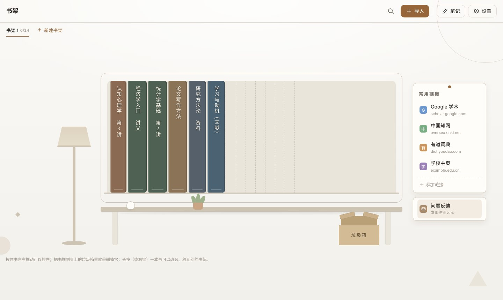
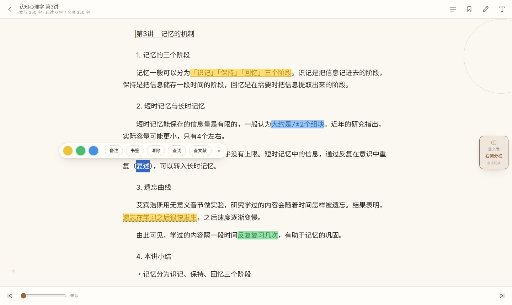
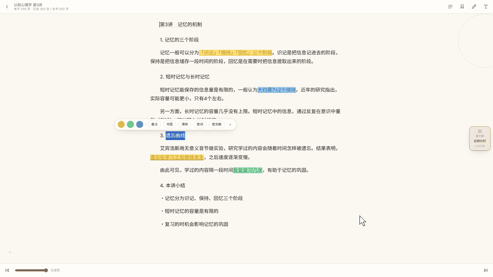
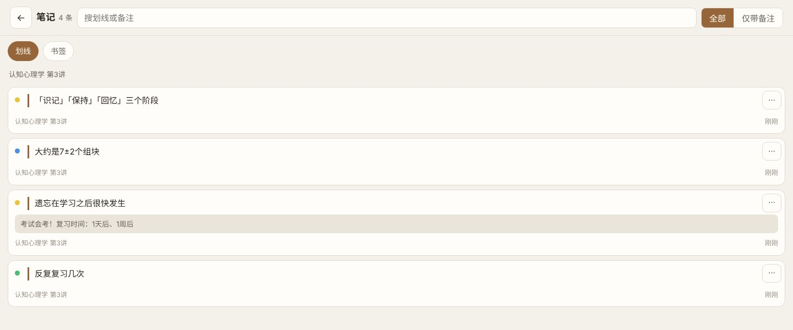

# E-Reader

[日本語](README.md) | [中文](README.zh-CN.md)

为大学上课、记笔记、读文献做的 Windows 电子书阅读器。

## 下载

**[下载最新版](https://github.com/toaru10124/E-Reader/releases/latest)**

## 使用方法

1. 右键 zip →「全部解压缩」
2. 双击 `E-Reader.exe`（出现蓝色警告时点「更多信息」→「仍要运行」）

※ 第一次打开可能会慢一点。

支持：Windows（用默认浏览器打开，推荐 Chrome / Edge）
格式：TXT / EPUB / PDF / DOCX / PPTX

## 功能

### 划线・笔记
选中文字，就能用不同颜色划线、写笔记。

### 查文献・查词典
选中的词可以马上用 Google Scholar、中国知网、有道等搜索，画面左右分开。

### 笔记
划线和笔记可以一起回看，还能导出成 Word。

## 关于数据

书和笔记保存在这台电脑的浏览器里。不用联网，也不用注册。

## 反馈

有问题或建议，欢迎在软件里的「问题反馈」或本页的「Issues」告诉我。
